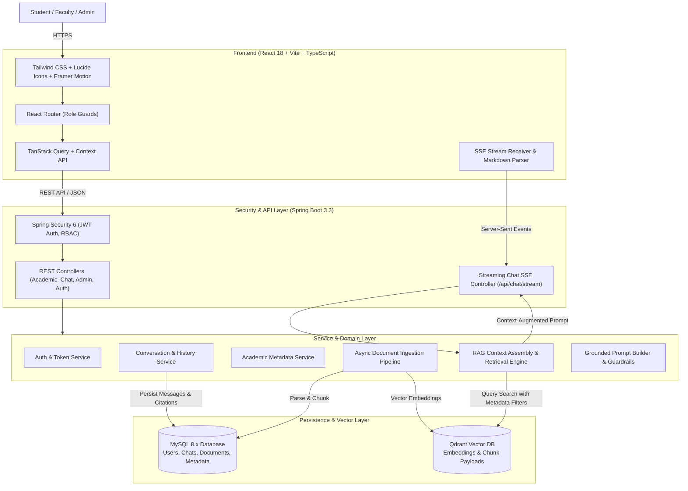

# AcademiQ | University Academic AI Assistant with RAG


An enterprise-ready, production-grade **University Academic Assistance Platform** powered by **Retrieval-Augmented Generation (RAG)**. The system provides students, faculty, and university administrators with verified, evidence-grounded answers to academic questions, exam policies, syllabus requirements, and course regulations—complete with source citations and exact page numbers from official university handbooks.

---

## 🏛️ System Architecture



---

## 🚀 Key Features

1. **Grounded Academic Retrieval (RAG)**:
   - Uses **Qdrant Vector Database** with HNSW indexing and cosine similarity.
   - Extracts and indexes PDF, DOCX, and TXT university handbooks.
   - Attaches metadata: `departmentId`, `courseId`, `semester`, `academicYear`, `pageNumber`, and `accessLevel`.
2. **Real-Time Token Streaming**:
   - Delivers answers via **Server-Sent Events (SSE)**.
   - Renders Markdown, syntax-highlighted code, tables, and mathematical notation.
3. **Exact Page Citations & Grounding Badges**:
   - Every claim derived from an official document includes a citation badge with document title, page number, confidence percentage, and source excerpt.
   - Clearly flags general educational explanations when no official document answers the query.
4. **Role-Based Access Control (RBAC)**:
   - Three distinct personas: `STUDENT`, `FACULTY`, `ADMIN`.
   - Admin upload and ingestion monitoring portal.
5. **Modern Academic UI/UX**:
   - Sleek dark and light mode toggle.
   - Responsive layouts for desktop, tablet, and mobile.
   - 1-click Quick Action cards for common questions (Attendance criteria, Grading scale, Syllabus summaries).

---

## 🛠️ Technology Stack

| Layer | Technologies |
|---|---|
| **Frontend** | React 18, Vite, TypeScript, Tailwind CSS, Lucide React, Framer Motion, React Router, TanStack Query, React Markdown |
| **Backend** | Java 21 LTS, Spring Boot 3.3.4, Spring Security 6, Spring Data JPA, Spring AI 1.0.0-M3, Flyway |
| **Relational DB** | MySQL 8.0 (Users, Chats, Messages, Citations, Academic Metadata, Feedback) |
| **Vector DB** | Qdrant (Dedicated Vector Database for embeddings, chunk payloads & metadata filtering) |
| **Document Processing** | Apache PDFBox 3.0, Apache POI 5.2 (DOCX), Recursive Character Splitter |
| **Containerization** | Docker, Docker Compose multi-container setup |

---

## ⚡ Quickstart Guide

### Option 1: Running Full Stack with Docker Compose

Ensure Docker is running on your machine:
```bash
# Clone the repository and navigate to docker/
cd docker

# Start MySQL 8, Qdrant Vector Store, Backend, and Frontend
docker compose up -d

# Check running services
docker compose ps
```

- **Frontend Application**: `http://localhost:3000`
- **Backend API**: `http://localhost:8080`
- **Swagger / OpenAPI Documentation**: `http://localhost:8080/swagger-ui.html`
- **Qdrant Vector Dashboard**: `http://localhost:6333/dashboard`

---

### Option 2: Running Locally for Development

#### 1. Start the Frontend
```bash
cd frontend
npm install
npm run dev
```
The React frontend starts at: `http://localhost:5173/`

#### 2. Start MySQL & Backend
```bash
# Verify MySQL 8 is running locally or start the service:
# Powershell: Get-Service MySQL81 | Start-Service

cd backend
# Build and run the Spring Boot application
mvn spring-boot:run
```

---

## 👥 Demo Personas & Credentials

You can test different roles directly via the 1-click role switcher in the top navbar or via the login page:

| Role | Name | Email | Password | Privileges |
|---|---|---|---|---|
| **Student** | Alex Johnson | `student@university.edu` | `Student@123456` | Full academic chat, syllabus viewer, attendance tracker |
| **Dean / Admin** | Dr. Sarah Mitchell | `admin@university.edu` | `Admin@123456` | Document ingestion manager, user RBAC governance, vector stats |
| **Faculty** | Prof. David Chen | `faculty@university.edu` | `Faculty@123456` | Course syllabus and academic resource management |

---

## 📂 Project Structure

```
chat-bot/
├── backend/
│   ├── pom.xml                                      # Maven configuration (Spring Boot 3.3, Spring AI, Qdrant)
│   └── src/
│       ├── main/
│       │   ├── java/com/university/academicassistant/
│       │   │   ├── AcademicAssistantApplication.java # Spring Boot entry point
│       │   │   ├── config/                          # Security, JWT, Async, OpenAPI configs
│       │   │   ├── auth/                            # AuthController, AuthService, JWT Token Provider
│       │   │   ├── user/                            # User entity, Role enum, UserRepository
│       │   │   ├── academic/                        # Department, Course, Subject models & APIs
│       │   │   ├── document/                        # Document, Parser (PDF/DOCX), Semantic Chunker
│       │   │   ├── rag/                             # RAGService, VectorStoreService (Qdrant), PromptEngine
│       │   │   ├── chat/                            # Conversation, Message, Citations, SSE Streamer
│       │   │   ├── feedback/                        # Answer ratings & quality feedback
│       │   │   ├── admin/                           # Ingestion stats, AdminController
│       │   │   └── common/                          # Global exception handler, Audit log
│       │   └── resources/
│       │       ├── application.yml                  # Database, Vector DB, and RAG configuration
│       │       └── db/migration/
│       │           └── V1__initial_schema.sql       # Flyway schema migration & seed data
│       └── test/                                    # Automated RAG and chunking unit tests
├── frontend/
│   ├── package.json                                 # React 18, Vite, Tailwind, Lucide dependencies
│   ├── vite.config.ts                               # Proxying & path aliases
│   ├── tailwind.config.js                           # Custom academic theme & typography
│   └── src/
│       ├── types/                                   # TypeScript interfaces
│       ├── context/                                 # AuthContext, ThemeContext
│       ├── services/                                # api, chatService, academicService, adminService
│       ├── components/                              # Navbar, Sidebar, MessageBubble, ChatInput, Citations
│       ├── pages/                                   # Landing, Login, Register, Chat, Dashboard, Resources
│       └── App.tsx                                  # Role-based route definitions
├── docker/
│   ├── Dockerfile.backend                           # Multi-stage JDK 21 build
│   ├── Dockerfile.frontend                          # Multi-stage Nginx build
│   └── docker-compose.yml                           # MySQL 8 + Qdrant + Backend + Frontend orchestration
├── docs/
│   ├── ARCHITECTURE.md                              # Detailed Architecture & ER diagrams
│   ├── API_DOCUMENTATION.md                         # OpenAPI REST & SSE streaming specifications
│   └── TROUBLESHOOTING.md                           # Operational runbook
├── sample-data/
│   ├── exam_regulations_2026.txt                    # Official exam & attendance regulations
│   ├── cs101_data_structures_syllabus.txt           # Unit-by-unit syllabus with CIE/ESE scheme
│   └── student_handbook_summary.txt                 # Campus housing & library policies
├── .env.example                                     # Environment variable template
└── README.md
```

---

## 🧪 Testing & Validation

Run backend unit and RAG evaluation tests:
```bash
cd backend
mvn test
```
Tests evaluate:
- Query retrieval precision against official documents.
- Automatic citation extraction with exact page numbers.
- Disclaimer fallback when query topics are absent from uploaded handbooks.
- Semantic chunking with token estimation and sentence boundary preservation.
- Stateless JWT authentication and password hashing.
